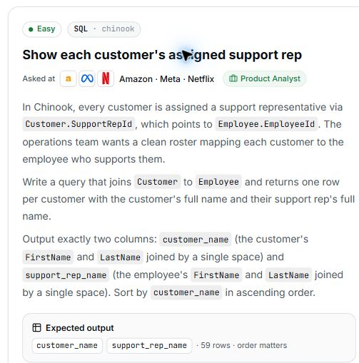

# 11. Show each customer's assigned support rep

**Difficulty:** Easy  
**Track / database:** SQL / Chinook  
**Practice status:** Final solution saved with assistance noted; viva closed at 5/5, grouping explanation supplied for revision

## Question

In Chinook, every customer is assigned a support representative via `Customer.SupportRepId`, which points to `Employee.EmployeeId`. The operations team wants a clean roster mapping each customer to the employee who supports them.

Write a query that joins `Customer` to `Employee` and returns **one row per customer** with the customer's full name and their support rep's full name.

Output exactly two columns:

- `customer_name`: the customer's `FirstName` and `LastName` joined by a single space.
- `support_rep_name`: the employee's `FirstName` and `LastName` joined by a single space.

Sort by `customer_name` in **ascending** order.

**Expected output:** `customer_name`, `support_rep_name` · 59 rows · order matters.

Source: [PrepNPlaced SQL practice](https://www.prepnplaced.com/data-practice), “Show each customer's assigned support rep”.

## Question image



The image is a capture of the question card from the practice page.

## Schema

SQL table names are case-sensitive according to the question.

### Album

`AlbumId, Title, ArtistId`

### Artist

`ArtistId, Name`

### Customer

`CustomerId, FirstName, LastName, Company, Address, City, State, Country, PostalCode, Phone, Fax, Email, SupportRepId`

### Employee

`EmployeeId, LastName, FirstName, Title, ReportsTo, BirthDate, HireDate, Address, City, State, Country, PostalCode, Phone, Fax, Email`

### Genre

`GenreId, Name`

### Invoice

`InvoiceId, CustomerId, InvoiceDate, BillingAddress, BillingCity, BillingState, BillingCountry, BillingPostalCode, Total`

### InvoiceLine

`InvoiceLineId, InvoiceId, TrackId, UnitPrice, Quantity`

### MediaType

`MediaTypeId, Name`

### Playlist

`PlaylistId, Name`

### PlaylistTrack

`PlaylistId, TrackId`

### Track

`TrackId, Name, AlbumId, MediaTypeId, GenreId, Composer, Milliseconds, Bytes, UnitPrice`

## My thinking process

After the failed attempt, I explicitly asked for the fix. I then confirmed the assisted correction below as my final solution. In the follow-up discussion, I explained that joining the first and last names directly would leave no space between them, so a space is needed. I also said that single quotes make it a string; the interviewer clarified that they mark literal text rather than convert the stored column value. I originally thought I needed to group the support rep with each of their customers. I asked for an explanation of why grouping was unnecessary; the explanation below was supplied by the interviewer.

## My solution

My attempt before the assisted correction, as visible in the practice editor when the failed result was reviewed:

```sql
select 'Customer.FirstName'+'Customer.LastName' as customer_name, ' Employee.FirstName' + 'Employee.LastName' as support_rep_name
from Customer
join Employee on Customer.SupportRepId = Employee.EmployeeId
group by Employee.EmployeeId
order by customer_name asc
```

The query above was transcribed from the visible editor. Formatting spaces outside string literals were normalized; the operators, grouping, and text inside single quotes are unchanged.

Revision history: my first attempt used `+` between the name references without single quotes around them. My second chat attempt added single quotes and included backticks. The backticks are absent from the actual editor version shown above; the single quotes, `+` operators, and grouping remain.

### My final solution (completed with assistance)

Originally provided by the assistant after I explicitly requested the fix, then shared by me as my final solution. This is not recorded as independently solved. Chat formatting artifacts were removed without changing the SQL.

```sql
SELECT
    Customer.FirstName || ' ' || Customer.LastName AS customer_name,
    Employee.FirstName || ' ' || Employee.LastName AS support_rep_name
FROM Customer
JOIN Employee ON Customer.SupportRepId = Employee.EmployeeId
ORDER BY customer_name ASC;
```

## What I learned

Feedback and explanation supplied with the assisted correction and viva (demonstrated understanding is recorded separately below):

- Single quotes create literal text. For example, `'Employee.LastName'` does not retrieve an employee's last name.
- In this SQL environment, `+` performs numeric addition. The nonnumeric strings in my expressions are converted to zero, explaining the `0` name results. Building full names requires string concatenation.
- Grouping by `Employee.EmployeeId` combines customers who share a support rep, conflicting with the requirement for one row per customer.
- The name expressions also need to place the required single space between first and last names.
- The correction uses `||` for string concatenation and `' '` for the single space. Column references remain outside single quotes.
- The join already returns each customer with their assigned employee. Removing the grouping preserves one row per customer.

Explanation requested after viva question 5: the required output is **one row per customer**. The join attaches the assigned employee to each customer using `SupportRepId = EmployeeId`. The expected result shows, for example, Camille Bernard and Daan Peeters both supported by Margaret Park; both customer rows must remain. `GROUP BY Employee.EmployeeId` would combine customers sharing that employee into one group, producing one output row for the rep instead of retaining each customer. This task asks for a roster, so the join supplies the required relationship without summarizing customers into groups. I have received this explanation but have not yet demonstrated the distinction in my own words.

Understanding demonstrated in the viva: I identified that omitting the space literal makes the names run together. The interviewer clarified the exact notation as a space enclosed in two single quotes: `' '`. I associated single quotes with strings; the clarification was that `'Customer.FirstName'` is literal text, while `Customer.FirstName` reads the column's value. Quoting the column name does not convert its stored value.

## Viva questions and my answers

**Viva questions asked:** 5 / 5 maximum.

No additional viva question was asked while providing the requested fix.

1. **Question:** Why did I group by `Employee.EmployeeId` when the output requires one row per customer?
   **My answer:** No verbal explanation recorded. The grouping was removed in the assisted correction, which I later confirmed as final.

2. **Question:** What purpose does `' '` serve between `FirstName` and `LastName` in my expression?
   **My answer:** "joins"
   **Review:** This does not yet distinguish the text literal from the joining operator. The interviewer clarified that `||` performs the joining.

3. **Question:** What would the full name look like if I joined `FirstName` directly to `LastName`, leaving out `' '`?
   **My answer:** `no space , thus need  ' "`
   **Review:** Correct reasoning: a space is needed between the names. The exact literal uses matching single quotes: `' '`.

4. **Question:** Why is `Customer.FirstName` outside single quotes in my final query?
   **My answer:** "using ' ' converts it into  a string"
   **Review:** Correct association with string literals. More precisely, single quotes mark literal text; they do not convert the column's stored value to a string. Without single quotes, `Customer.FirstName` refers to the column's value.

5. **Question:** Why does my final query not need `GROUP BY`?
   **My answer:** "bcz it was asked for a straight forward question....i thought that i needs grouping support rep for each of its customer"
   **Follow-up request:** "woulod u please explain why group by is not needed"
   **Review:** This explains my original confusion but does not yet establish why grouping changes the required output. At my request, the interviewer explained that the join connects each customer to their rep, while grouping by employee combines those customer rows into one output group per rep. The deciding requirement is one row per customer, rather than whether the question seems straightforward.

Viva closed at the five-question limit. The final query is correct by inspection and was completed with assistance. Grouping versus preserving individual customer rows remains a revision point; the supplied explanation is not recorded as independently demonstrated understanding.

## Validation

Review by inspection: the intended join links the correct columns, `Customer.SupportRepId` and `Employee.EmployeeId`. The output aliases and ascending sort match the prompt.

Observed failure: my supplied screenshot and the live practice page both show **Wrong answer**. The page lists expected full-name pairs as missing and three `0 · 0` rows as extra. The editor uses quoted column-name text, arithmetic `+`, and grouping by employee, as recorded above.

The assistant inspected the existing editor and result without running or submitting another query. No successful result has been recorded yet.

Final solution reviewed by inspection: it reads the actual name columns, concatenates each pair with a single space, retains the correct join, preserves customer rows without aggregation, and sorts by `customer_name`. This corrected query has not been executed or accepted in the recorded discussion.

Comparison with the supplied reference: the queries have the same logic. The reference uses short table aliases and reverses the sides of the equality in the join condition; those differences do not change the result. The reference SQL and explanation are not copied into these notes.


The image is a capture of the existing result panel from the practice page.
