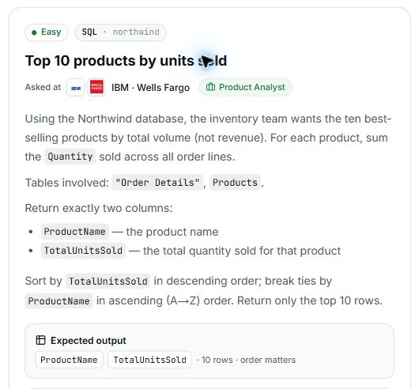

# 13. Top 10 products by units sold

**Difficulty:** Easy  
**Track / database:** SQL / Northwind  
**Practice status:** My final solution confirmed and saved; viva complete after 3 questions

## Question

Using the Northwind database, the inventory team wants the ten best-selling products by total volume (not revenue). For each product, sum the `Quantity` sold across all order lines.

Tables involved: `"Order Details"`, `Products`.

Return exactly two columns:

- `ProductName`: the product name.
- `TotalUnitsSold`: the total quantity sold for that product.

Sort by `TotalUnitsSold` in **descending** order; break ties by `ProductName` in **ascending (A–Z)** order. Return only the **top 10 rows**.

**Expected output:** `ProductName`, `TotalUnitsSold` · 10 rows · order matters.

Source: [PrepNPlaced SQL practice](https://www.prepnplaced.com/data-practice), “Top 10 products by units sold”.

## Question image



The image is a capture of the question card from the practice page.

## Schema

SQL table names are case-sensitive according to the question.

### Categories

`CategoryID, CategoryName, Description, Picture`

### CustomerCustomerDemo

`CustomerID, CustomerTypeID`

### CustomerDemographics

`CustomerTypeID, CustomerDesc`

### Customers

`CustomerID, CompanyName, ContactName, ContactTitle, Address, City, Region, PostalCode, Country, Phone, Fax`

### EmployeeTerritories

`EmployeeID, TerritoryID`

### Employees

`EmployeeID, LastName, FirstName, Title, TitleOfCourtesy, BirthDate, HireDate, Address, City, Region, PostalCode, Country, HomePhone, Extension, Photo, Notes, ReportsTo, PhotoPath`

### Order Details

`OrderID, ProductID, UnitPrice, Quantity, Discount`

### Orders

`OrderID, CustomerID, EmployeeID, OrderDate, RequiredDate, ShippedDate, ShipVia, Freight, ShipName, ShipAddress, ShipCity, ShipRegion, ShipPostalCode, ShipCountry`

### Products

`ProductID, ProductName, SupplierID, CategoryID, QuantityPerUnit, UnitPrice, UnitsInStock, UnitsOnOrder, ReorderLevel, Discontinued`

### Regions

`RegionID, RegionDescription`

### Shippers

`ShipperID, CompanyName, Phone`

### Suppliers

`SupplierID, CompanyName, ContactName, ContactTitle, Address, City, Region, PostalCode, Country, Phone, Fax, HomePage`

### Territories

`TerritoryID, TerritoryDescription, RegionID`

## My thinking process

I used `SUM(Quantity)` because the question asks to sum the quantity sold across all order lines. I explained that using a count would give a count rather than the required total quantity. I joined `Products` because the output also needs the product name. For the sorting, I pointed to the requirement to sort total units descending and break ties using product names in ascending order.

## My solution

### My final solution

```sql
select ProductName , sum ("Order Details".Quantity) as TotalUnitsSold
from "Order Details"
join Products on Products.ProductID = "Order Details".ProductID
group by Products.ProductID
order by TotalUnitsSold desc , ProductName asc
limit 10
```

I explicitly confirmed this query as my final solution. My initial attempt had the same logic and used backticks around the two names in `ORDER BY`; I removed those backticks in my final version. Chat formatting artifacts (including line-break backslashes) and repeated spacing were normalized without changing the SQL logic.

## What I learned

I distinguished adding quantities from counting. The interviewer clarified the precise difference in this query: `SUM(Quantity)` adds the units sold within each product group, while `COUNT(*)` counts the order-line rows in that group.

I identified the need for the product name as the reason for joining `Products`. `Quantity` comes from `"Order Details"`, while `ProductName` comes from `Products`.

I identified the prompt's alphabetical tie-breaking requirement. The interviewer confirmed that `ProductName ASC` orders products alphabetically when their `TotalUnitsSold` values are equal.

## Viva questions and my answers

**Viva questions asked:** 3 / 5 maximum.

1. **Question:** Why did I choose `SUM(Quantity)` rather than `COUNT(*)` for `TotalUnitsSold`?
   **My answer:** "as per the question - sum the Quantity sold across all order lines. if i would have used count ...than it would have given me count and not the total"
   **Review:** Correct distinction between summing quantities and counting. The interviewer clarified that `COUNT(*)` counts order-line rows, while `SUM(Quantity)` totals their units.

2. **Question:** Why did I join `Products` when `Quantity` is already in `"Order Details"`?
   **My answer:** "but we needed product name as well"
   **Review:** Correct: the required `ProductName` is in `Products`, so the join supplies that output value.

3. **Question:** What purpose does `ProductName ASC` serve after `TotalUnitsSold DESC` in my sorting?
   **My answer:** Mentioned in the question: “Sort by `TotalUnitsSold` in descending order; break ties by `ProductName` in ascending (A–Z) order. Return only the top 10 rows.”
   **Review:** Correctly identified alphabetical ordering as the required tie-breaker for equal total quantities.

Viva complete after three questions. I distinguished summing quantities from counting, explained why the join supplies the product name, and identified the tie-breaking requirement. No further viva questions are needed for this review.

## Validation

Reviewed by inspection: the query joins the two requested tables on `ProductID`, groups by product, sums the order-line quantities, returns `ProductName` and `TotalUnitsSold`, sorts by total units descending with product name ascending to break ties, and limits the output to ten rows. These choices match the question's requirements.

Comparison with the supplied reference: the join keys, quantity calculation, output columns, sorting, and row limit agree. The reference uses short table aliases and groups by `ProductName`; my solution retains the full table names and groups by `Products.ProductID`. My own query is preserved. The official SQL and its explanation are not copied into these notes.

No query execution or result has been recorded in this practice discussion yet. The viva review is complete; this does not establish an executed or accepted result.
