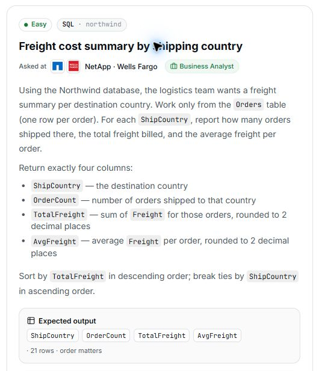

# 14. Freight cost summary by shipping country

**Difficulty:** Easy  
**Track / database:** SQL / Northwind  
**Practice status:** My final solution confirmed and saved; viva complete after 3 questions

## Question

Using the Northwind database, the logistics team wants a freight summary per destination country. Work only from the `Orders` table (one row per order). For each `ShipCountry`, report how many orders shipped there, the total freight billed, and the average freight per order.

Return exactly four columns:

- `ShipCountry`: the destination country.
- `OrderCount`: number of orders shipped to that country.
- `TotalFreight`: sum of `Freight` for those orders, rounded to **2 decimal places**.
- `AvgFreight`: average `Freight` per order, rounded to **2 decimal places**.

Sort by `TotalFreight` in **descending** order; break ties by `ShipCountry` in **ascending** order.

**Expected output:** `ShipCountry`, `OrderCount`, `TotalFreight`, `AvgFreight` · 21 rows · order matters.

Source: [PrepNPlaced SQL practice](https://www.prepnplaced.com/data-practice), “Freight cost summary by shipping country”.

## Question image



The image is a capture of the question card from the practice page.

## Schema

SQL table names are case-sensitive according to the question.

### Categories

`CategoryID, CategoryName, Description, Picture`

### CustomerCustomerDemo

`CustomerID, CustomerTypeID`

### CustomerDemographics

`CustomerTypeID, CustomerDesc`

### Customers

`CustomerID, CompanyName, ContactName, ContactTitle, Address, City, Region, PostalCode, Country, Phone, Fax`

### EmployeeTerritories

`EmployeeID, TerritoryID`

### Employees

`EmployeeID, LastName, FirstName, Title, TitleOfCourtesy, BirthDate, HireDate, Address, City, Region, PostalCode, Country, HomePhone, Extension, Photo, Notes, ReportsTo, PhotoPath`

### Order Details

`OrderID, ProductID, UnitPrice, Quantity, Discount`

### Orders

`OrderID, CustomerID, EmployeeID, OrderDate, RequiredDate, ShippedDate, ShipVia, Freight, ShipName, ShipAddress, ShipCity, ShipRegion, ShipPostalCode, ShipCountry`

### Products

`ProductID, ProductName, SupplierID, CategoryID, QuantityPerUnit, UnitPrice, UnitsInStock, UnitsOnOrder, ReorderLevel, Discontinued`

### Regions

`RegionID, RegionDescription`

### Shippers

`ShipperID, CompanyName, Phone`

### Suppliers

`SupplierID, CompanyName, ContactName, ContactTitle, Address, City, Region, PostalCode, Country, Phone, Fax, HomePage`

### Territories

`TerritoryID, TerritoryDescription, RegionID`

## My thinking process

I calculated the average by dividing the total freight by the number of orders, explaining that “avg is total / no of order.” When asked for a direct aggregate alternative, I identified `AVG`. I used `GROUP BY ShipCountry` because the question asks for the order count, total freight, and average freight for each shipping country.

## My solution

### First attempt

```sql
select ShipCountry , OrderCount , round (sum(`Freight`),2) as TotalFreight , round(sum(`Freight`)/count( Orders.OrderID)),2) as AvgFreight
from `Orders`
group by ShipCountry
order by `TotalFreight` desc , `ShipCountry` asc
```

Nonbreaking spaces and repeated spacing were normalized. The unresolved `OrderCount` reference and the parentheses in the average expression are preserved from my attempt.

### My final solution

```sql
select ShipCountry , count( Orders.OrderID) as OrderCount , round (sum(Freight),2) as TotalFreight , round(sum(Freight)/count( Orders.OrderID),2) as AvgFreight
from Orders
group by ShipCountry
order by TotalFreight desc , ShipCountry asc
```

I replaced the bare `OrderCount` reference with a count expression and its output alias, and corrected the parentheses in the average expression. I then explicitly confirmed the query above as my final solution, removing the identifier backticks in my final version. Chat formatting artifacts and repeated spacing were normalized without changing my SQL logic.

## What I learned

Review feedback addressed in my revision:

- `OrderCount` is a required output name, but it is not a column in the supplied `Orders` schema. I now calculate the number of orders and give it that alias.
- In the original `AvgFreight` expression, the parentheses closed `round` before its `,2` precision argument. I corrected the parentheses so both arguments are inside the rounding function.

These corrections are visible in my final query. In the viva, I explained my average calculation as total freight divided by the number of orders. The earlier comparison note about `NULL` freight remains applicable; it has not been discussed in my own explanation.

I correctly identified `AVG()` as the aggregate function that calculates an average directly. My final query above retains my original sum-divided-by-count approach.

I identified “For each ShipCountry” as the reason for grouping. The interviewer confirmed that this produces a separate summary for each country.

## Viva questions and my answers

**Viva questions asked:** 3 / 5 maximum.

1. **Question:** Why did I divide `SUM(Freight)` by `COUNT(Orders.OrderID)` to calculate `AvgFreight`?
   **My answer:** "avg is total / no of order"
   **Review:** Correctly explained the intended arithmetic: total freight divided by the number of orders. This explains my choice without establishing that it is interchangeable with a direct average aggregate for every input.

2. **Question:** Which SQL aggregate function could calculate the average directly?
   **My answer:** "avg"
   **Review:** Correctly identified `AVG()` as the direct aggregate function.

3. **Question:** Why did I use `GROUP BY ShipCountry` in this query?
   **My answer:** As per the question: “For each `ShipCountry`, report how many orders shipped there, the total freight billed, and the average freight per order.”
   **Review:** Correctly identified the requirement for a separate set of aggregate results for each shipping country.

Viva complete after three questions. I explained the arithmetic behind my average, identified the direct average aggregate, and linked grouping to the per-country requirement. The earlier `NULL`-handling comparison remains a review note rather than a concept demonstrated in my answers. No further viva questions are needed for this review.

## Validation

Reviewed by inspection: using only `Orders`, grouping by `ShipCountry`, rounding the total freight, and sorting by total freight descending then country ascending match the corresponding requirements. My final query resolves the previously identified order-count reference and rounding syntax issues. Its average expression divides total freight by the count of order IDs and rounds the result to two decimal places.

Comparison with the supplied reference: the grouping, output names, rounding precision, and sorting agree. The reference counts rows and uses a direct average aggregate; my query counts `OrderID` values and divides the freight sum by that count. A distinction noted by the interviewer: `AVG(Freight)` excludes `NULL` freight values from its denominator, whereas my denominator counts non-NULL order IDs even when their freight is `NULL`. The average expressions are therefore not universally interchangeable. My own final query is preserved; the official SQL and its explanation are not copied into these notes.

No query execution or result has been recorded in this practice discussion yet.
