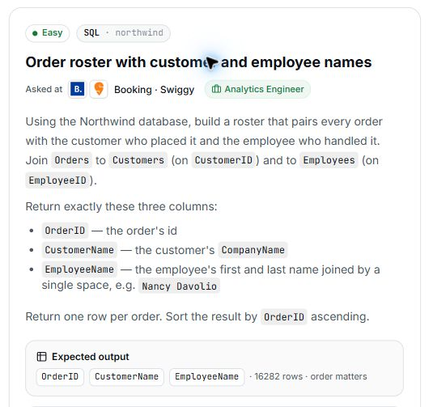

# 15. Order roster with customer and employee names

## Question and image

Using the Northwind database, build a roster that pairs every order with the customer who placed it and the employee who handled it. Join `Orders` to `Customers` (on `CustomerID`) and to `Employees` (on `EmployeeID`).

Return exactly these three columns:

- `OrderID`: the order's id.
- `CustomerName`: the customer's `CompanyName`.
- `EmployeeName`: the employee's first and last name joined by a single space, e.g. `Nancy Davolio`.

Return **one row per order**. Sort the result by `OrderID` **ascending**.

**Expected output:** `OrderID`, `CustomerName`, `EmployeeName` · 16282 rows · order matters.



## Schema

SQL table names are case-sensitive according to the question.

### Categories

`CategoryID, CategoryName, Description, Picture`

### CustomerCustomerDemo

`CustomerID, CustomerTypeID`

### CustomerDemographics

`CustomerTypeID, CustomerDesc`

### Customers

`CustomerID, CompanyName, ContactName, ContactTitle, Address, City, Region, PostalCode, Country, Phone, Fax`

### EmployeeTerritories

`EmployeeID, TerritoryID`

### Employees

`EmployeeID, LastName, FirstName, Title, TitleOfCourtesy, BirthDate, HireDate, Address, City, Region, PostalCode, Country, HomePhone, Extension, Photo, Notes, ReportsTo, PhotoPath`

### Order Details

`OrderID, ProductID, UnitPrice, Quantity, Discount`

### Orders

`OrderID, CustomerID, EmployeeID, OrderDate, RequiredDate, ShippedDate, ShipVia, Freight, ShipName, ShipAddress, ShipCity, ShipRegion, ShipPostalCode, ShipCountry`

### Products

`ProductID, ProductName, SupplierID, CategoryID, QuantityPerUnit, UnitPrice, UnitsInStock, UnitsOnOrder, ReorderLevel, Discontinued`

### Regions

`RegionID, RegionDescription`

### Shippers

`ShipperID, CompanyName, Phone`

### Suppliers

`SupplierID, CompanyName, ContactName, ContactTitle, Address, City, Region, PostalCode, Country, Phone, Fax, HomePage`

### Territories

`TerritoryID, TerritoryDescription, RegionID`

## My solution — SQLite

```sql
select Orders. OrderID as OrderID , Customers. CompanyName as CustomerName , Employees.FirstName || ' ' || LastName as EmployeeName
from Customers
join Orders on Orders.CustomerID = Customers .CustomerID
join Employees on Orders.EmployeeID = Employees.EmployeeID
order by OrderID asc
```

## My solution — SQL Server

```sql
select Orders. OrderID as OrderID , Customers. CompanyName as CustomerName , Employees.FirstName + ' ' + LastName as EmployeeName
from Customers
join Orders on Orders.CustomerID = Customers .CustomerID
join Employees on Orders.EmployeeID = Employees.EmployeeID
order by OrderID asc
```

## Official solution

```sql
SELECT
    o.OrderID AS OrderID,
    c.CompanyName AS CustomerName,
    e.FirstName || ' ' || e.LastName AS EmployeeName
FROM Orders o
JOIN Customers c ON o.CustomerID = c.CustomerID
JOIN Employees e ON o.EmployeeID = e.EmployeeID
ORDER BY o.OrderID ASC;
```

### What this tests

Joining three related tables, selecting and aliasing columns, and concatenating a full name.

### The approach

Start from Orders; join Customers on CustomerID and Employees on EmployeeID; return the order ID, customer company name, and employee full name; sort by OrderID.

### Why this way

Orders contains both foreign keys, so the joins attach the customer and employee details to each order.

### Common mistakes

Using incorrect aliases, returning first and last names separately, or selecting extra columns.
