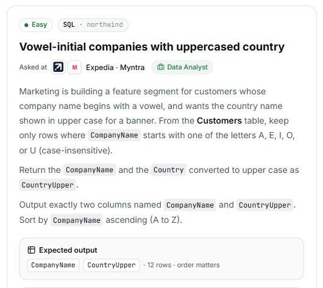

# 18. Vowel-initial companies with uppercased country

## Question and image

Marketing is building a feature segment for customers whose company name begins with a vowel, and wants the country name shown in upper case for a banner. From the **Customers** table, keep only rows where `CompanyName` starts with one of the letters **A, E, I, O, or U (case-insensitive)**.

Return the `CompanyName` and the `Country` converted to upper case as `CountryUpper`.

Output exactly two columns named `CompanyName` and `CountryUpper`. Sort by `CompanyName` **ascending (A to Z)**.

**Expected output:** `CompanyName`, `CountryUpper` · 12 rows · order matters.



## Schema

SQL table names are case-sensitive according to the question.

### Categories

`CategoryID, CategoryName, Description, Picture`

### CustomerCustomerDemo

`CustomerID, CustomerTypeID`

### CustomerDemographics

`CustomerTypeID, CustomerDesc`

### Customers

`CustomerID, CompanyName, ContactName, ContactTitle, Address, City, Region, PostalCode, Country, Phone, Fax`

### EmployeeTerritories

`EmployeeID, TerritoryID`

### Employees

`EmployeeID, LastName, FirstName, Title, TitleOfCourtesy, BirthDate, HireDate, Address, City, Region, PostalCode, Country, HomePhone, Extension, Photo, Notes, ReportsTo, PhotoPath`

### Order Details

`OrderID, ProductID, UnitPrice, Quantity, Discount`

### Orders

`OrderID, CustomerID, EmployeeID, OrderDate, RequiredDate, ShippedDate, ShipVia, Freight, ShipName, ShipAddress, ShipCity, ShipRegion, ShipPostalCode, ShipCountry`

### Products

`ProductID, ProductName, SupplierID, CategoryID, QuantityPerUnit, UnitPrice, UnitsInStock, UnitsOnOrder, ReorderLevel, Discontinued`

### Regions

`RegionID, RegionDescription`

### Shippers

`ShipperID, CompanyName, Phone`

### Suppliers

`SupplierID, CompanyName, ContactName, ContactTitle, Address, City, Region, PostalCode, Country, Phone, Fax, HomePage`

### Territories

`TerritoryID, TerritoryDescription, RegionID`

## My solution — SQLite

```sql
select CompanyName, UPPER(Country) as CountryUpper
from Customers
where CompanyName like 'a%' OR CompanyName like 'A%' or
CompanyName like 'E%' OR CompanyName like 'e% ' or
CompanyName like 'i%' OR CompanyName like 'I%' or
CompanyName like 'O%' OR CompanyName like 'o%' or
CompanyName like 'u%' OR CompanyName like 'U% '
order by CompanyName asc
```

## My solution — SQL Server

```sql
select CompanyName, UPPER(Country) as CountryUpper
from Customers
where CompanyName like '[aeiouAEIOU]%'
order by CompanyName asc
```

## Official solution

```sql
SELECT CompanyName,
       UPPER(Country) AS CountryUpper
FROM Customers
WHERE UPPER(substr(CompanyName, 1, 1)) IN ('A', 'E', 'I', 'O', 'U')
ORDER BY CompanyName ASC;
```

### What this tests

Combining string extraction, case conversion, and filtering.

### The approach

Uppercase Country for the output; extract and uppercase the first character of CompanyName; keep vowels with IN; sort by company name.

### Why this way

Checking an uppercased initial against one vowel list is concise and avoids separate uppercase and lowercase conditions.

### Common mistakes

Using incorrect output aliases, missing or incomplete vowel filtering, or failing to handle letter case.
