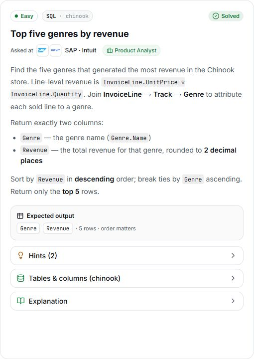

# 2. Top five genres by revenue

**Difficulty:** Easy  
**Track / database:** SQL / Chinook  
**Practice status:** Solution drafted; viva closed; execution not yet verified

## Question

Find the five genres that generated the most revenue in the Chinook store. Line-level revenue is `InvoiceLine.UnitPrice * InvoiceLine.Quantity`. Join `InvoiceLine` → `Track` → `Genre` to attribute each sold line to a genre.

Return exactly two columns:

- `Genre` — the genre name (`Genre.Name`).
- `Revenue` — the total revenue for that genre, rounded to **2 decimal places**.

Sort by `Revenue` in **descending** order; break ties by `Genre` ascending. Return only the **top 5 rows**.

**Expected output:** `Genre`, `Revenue` · 5 rows · order matters.

Source: [PrepNPlaced SQL practice](https://www.prepnplaced.com/data-practice), “Top five genres by revenue”.

## Question image



## Schema

SQL table names are case-sensitive according to the question.

### Album

`AlbumId, Title, ArtistId`

### Artist

`ArtistId, Name`

### Customer

`CustomerId, FirstName, LastName, Company, Address, City, State, Country, PostalCode, Phone, Fax, Email, SupportRepId`

### Employee

`EmployeeId, LastName, FirstName, Title, ReportsTo, BirthDate, HireDate, Address, City, State, Country, PostalCode, Phone, Fax, Email`

### Genre

`GenreId, Name`

### Invoice

`InvoiceId, CustomerId, InvoiceDate, BillingAddress, BillingCity, BillingState, BillingCountry, BillingPostalCode, Total`

### InvoiceLine

`InvoiceLineId, InvoiceId, TrackId, UnitPrice, Quantity`

### MediaType

`MediaTypeId, Name`

### Playlist

`PlaylistId, Name`

### PlaylistTrack

`PlaylistId, TrackId`

### Track

`TrackId, Name, AlbumId, MediaTypeId, GenreId, Composer, Milliseconds, Bytes, UnitPrice`

## My thinking process

- I used `Track` between `InvoiceLine` and `Genre` because there is no direct bridge between the two.
- The connecting columns are `TrackId` for `InvoiceLine` to `Track`, and `GenreId` for `Track` to `Genre`, as used in my query.
- I grouped by `Genre.GenreId` because the question asks for the five genres with the most revenue.
- I chose `InvoiceLine.UnitPrice` because the question explicitly specifies it.

## My solution

### Current attempt (3)

My revised attempt, saved as written. I added rounding to two decimal places in attempt 2 and corrected `asec` to `asc` in attempt 3. Viva questioning has ended; query execution has not been verified.

```sql
select Genre.Name as Genre , round (sum(InvoiceLine.UnitPrice * InvoiceLine.Quantity),2) as Revenue
from InvoiceLine
join Track on InvoiceLine.TrackId = Track.TrackId
join  Genre on Genre.GenreId=Track.GenreId
group by Genre.GenreId
order by Revenue desc, Genre asc
limit 5
```

## What I learned

- I need to check the output requirements as well as the calculation. My first attempt calculated total revenue but omitted the required rounding to two decimal places; I added it in my second attempt.
- The SQL keyword for ascending order is `asc`. I corrected my typo `asec` in the genre tie-breaker.
- In the practice example, three different tracks with IDs `101`, `102`, and `103` produce three groups when grouped by `TrackId`, even though all belong to Rock. Grouping those same tracks by their shared `GenreId` produces one group.

## Viva questions and my answers

Viva closed. The earlier discussion is consolidated into five entries below. No further viva questions will be asked for this problem.

### 1. Compare my Revenue expression with the output requirements: what is still missing?

**My response in code:** I added `round(...,2)` around the sum to meet the requirement for two decimal places.

### 2. Check Genre asec in my ORDER BY clause: what is the correct SQL keyword for ascending order?

**My response in code:** I changed `Genre asec` to `Genre asc`.

### 3. Why is Track needed between InvoiceLine and Genre instead of joining the two directly?

**My answer:** There is no direct bridge between `InvoiceLine` and `Genre`.

**Join keys I identified:** `TrackId`, `GenreId`.

**Connection in my query:** `InvoiceLine.TrackId = Track.TrackId`, then `Track.GenreId = Genre.GenreId`.

### 4. Why did I group by Genre.GenreId rather than Track.TrackId?

**My answer:** Because the question asks for the five genres with the most revenue.

**Earlier clarification:** I asked for a simpler example. For three Rock tracks with different track IDs, I answered that grouping by `TrackId` creates **3** groups and grouping by their shared `GenreId` creates **1** group.

### 5. Both Track and InvoiceLine have UnitPrice. Why did I use InvoiceLine.UnitPrice to calculate revenue?

**My answer:** Because it is stated in the question.

## Validation

No query execution or result has been recorded in this practice discussion yet.
