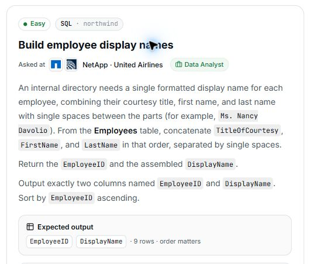

# 20. Build employee display names

## Question and image

An internal directory needs a single formatted display name for each employee, combining their courtesy title, first name, and last name with single spaces between the parts (for example, `Ms. Nancy Davolio`). From the **Employees** table, concatenate `TitleOfCourtesy`, `FirstName`, and `LastName` in that order, separated by single spaces.

Return the `EmployeeID` and the assembled `DisplayName`.

Output exactly two columns named `EmployeeID` and `DisplayName`. Sort by `EmployeeID` **ascending**.

**Expected output:** `EmployeeID`, `DisplayName` · 9 rows · order matters.

## Schema

SQL table names are case-sensitive according to the question.

### Categories

`CategoryID, CategoryName, Description, Picture`

### CustomerCustomerDemo

`CustomerID, CustomerTypeID`

### CustomerDemographics

`CustomerTypeID, CustomerDesc`

### Customers

`CustomerID, CompanyName, ContactName, ContactTitle, Address, City, Region, PostalCode, Country, Phone, Fax`

### EmployeeTerritories

`EmployeeID, TerritoryID`

### Employees

`EmployeeID, LastName, FirstName, Title, TitleOfCourtesy, BirthDate, HireDate, Address, City, Region, PostalCode, Country, HomePhone, Extension, Photo, Notes, ReportsTo, PhotoPath`

### Order Details

`OrderID, ProductID, UnitPrice, Quantity, Discount`

### Orders

`OrderID, CustomerID, EmployeeID, OrderDate, RequiredDate, ShippedDate, ShipVia, Freight, ShipName, ShipAddress, ShipCity, ShipRegion, ShipPostalCode, ShipCountry`

### Products

`ProductID, ProductName, SupplierID, CategoryID, QuantityPerUnit, UnitPrice, UnitsInStock, UnitsOnOrder, ReorderLevel, Discontinued`

### Regions

`RegionID, RegionDescription`

### Shippers

`ShipperID, CompanyName, Phone`

### Suppliers

`SupplierID, CompanyName, ContactName, ContactTitle, Address, City, Region, PostalCode, Country, Phone, Fax, HomePage`

### Territories

`TerritoryID, TerritoryDescription, RegionID`

## My solution — SQLite

Pending — awaiting my final SQLite solution.

## My solution — SQL Server

Pending — to be generated from my final SQLite solution.

## Official solution

Pending — awaiting the official solution and explanation.

### What this tests

Pending.

### The approach

Pending.

### Why this way

Pending.

### Common mistakes

Pending.
