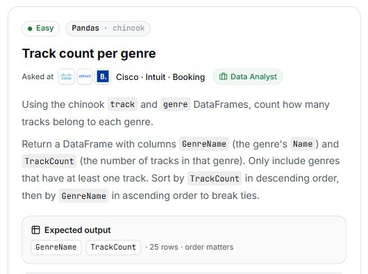

# 21. Track count per genre

## Question and image

The supplied question is a Pandas exercise. At my request, this version is adapted for SQLite and SQL Server using the corresponding Chinook tables.

Using the Chinook `Track` and `Genre` tables, count how many tracks belong to each genre.

Return exactly two columns:

- `GenreName` — the genre's `Name`.
- `TrackCount` — the number of tracks in that genre.

Only include genres that have **at least one track**. Sort by `TrackCount` in **descending** order, then by `GenreName` in **ascending** order to break ties.

**Expected output:** `GenreName`, `TrackCount` · 25 rows · order matters.

## Schema

SQL table names are shown with their corresponding supplied DataFrame variable names in parentheses. Column names are unchanged.

### Album (`album`)

`AlbumId, Title, ArtistId`

### Artist (`artist`)

`ArtistId, Name`

### Customer (`customer`)

`CustomerId, FirstName, LastName, Company, Address, City, State, Country, PostalCode, Phone, Fax, Email, SupportRepId`

### Employee (`employee`)

`EmployeeId, LastName, FirstName, Title, ReportsTo, BirthDate, HireDate, Address, City, State, Country, PostalCode, Phone, Fax, Email`

### Genre (`genre`)

`GenreId, Name`

### Invoice (`invoice`)

`InvoiceId, CustomerId, InvoiceDate, BillingAddress, BillingCity, BillingState, BillingCountry, BillingPostalCode, Total`

### InvoiceLine (`invoice_line`)

`InvoiceLineId, InvoiceId, TrackId, UnitPrice, Quantity`

### MediaType (`media_type`)

`MediaTypeId, Name`

### Playlist (`playlist`)

`PlaylistId, Name`

### PlaylistTrack (`playlist_track`)

`PlaylistId, TrackId`

### Track (`track`)

`TrackId, Name, AlbumId, MediaTypeId, GenreId, Composer, Milliseconds, Bytes, UnitPrice`

## My solution — SQLite

Pending — awaiting my final SQLite solution.

## My solution — SQL Server

Pending — to be generated from my final SQLite solution.

## Official solution

Pending — awaiting the official solution and explanation.

### What this tests

Pending.

### The approach

Pending.

### Why this way

Pending.

### Common mistakes

Pending.
