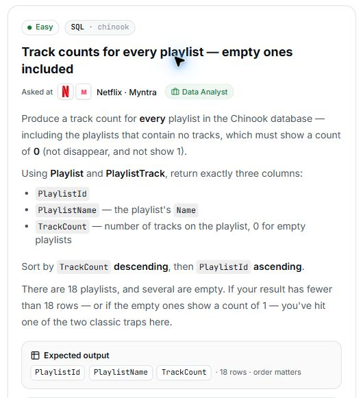

# 24. Track counts for every playlist — empty ones included

## Question and image

Produce a track count for **every playlist** in the Chinook database, including playlists that contain no tracks. Empty playlists must show a count of `0`; they must not disappear or show `1`.

Using **Playlist** and **PlaylistTrack**, return exactly three columns:

- `PlaylistId`.
- `PlaylistName` — the playlist's `Name`.
- `TrackCount` — number of tracks on the playlist, with `0` for empty playlists.

Sort by `TrackCount` **descending**, then `PlaylistId` **ascending**.

There are 18 playlists, and several are empty. A result with fewer than 18 rows, or with empty playlists showing `1`, has encountered one of the two classic traps in this question.

**Expected output:** `PlaylistId`, `PlaylistName`, `TrackCount` · 18 rows · order matters.

## Schema

SQL table names are case-sensitive according to the question.

### Album

`AlbumId, Title, ArtistId`

### Artist

`ArtistId, Name`

### Customer

`CustomerId, FirstName, LastName, Company, Address, City, State, Country, PostalCode, Phone, Fax, Email, SupportRepId`

### Employee

`EmployeeId, LastName, FirstName, Title, ReportsTo, BirthDate, HireDate, Address, City, State, Country, PostalCode, Phone, Fax, Email`

### Genre

`GenreId, Name`

### Invoice

`InvoiceId, CustomerId, InvoiceDate, BillingAddress, BillingCity, BillingState, BillingCountry, BillingPostalCode, Total`

### InvoiceLine

`InvoiceLineId, InvoiceId, TrackId, UnitPrice, Quantity`

### MediaType

`MediaTypeId, Name`

### Playlist

`PlaylistId, Name`

### PlaylistTrack

`PlaylistId, TrackId`

### Track

`TrackId, Name, AlbumId, MediaTypeId, GenreId, Composer, Milliseconds, Bytes, UnitPrice`

## My solution — SQLite

Pending — awaiting my final SQLite solution.

## My solution — SQL Server

Pending — to be generated from my final SQLite solution.

## Official solution

Pending — awaiting the official solution and explanation.

### What this tests

Pending.

### The approach

Pending.

### Why this way

Pending.

### Common mistakes

Pending.
