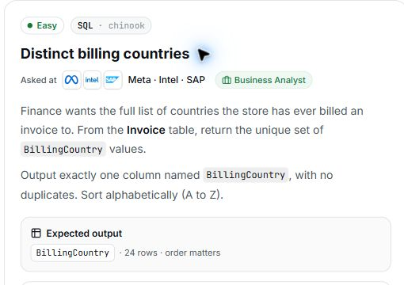

# 5. Distinct billing countries

**Difficulty:** Easy  
**Track / database:** SQL / Chinook  
**Practice status:** Final solution saved; viva closed; execution not verified

## Question

Finance wants the full list of countries the store has ever billed an invoice to. From the `Invoice` table, return the unique set of `BillingCountry` values.

Output exactly one column named `BillingCountry`, with no duplicates. Sort alphabetically (A to Z).

**Expected output:** `BillingCountry` · 24 rows · order matters.

Source: [PrepNPlaced SQL practice](https://www.prepnplaced.com/data-practice), “Distinct billing countries”.

## Question image



The image is a capture of the question card from the practice page.

## Schema

SQL table names are case-sensitive according to the question.

### Album

`AlbumId, Title, ArtistId`

### Artist

`ArtistId, Name`

### Customer

`CustomerId, FirstName, LastName, Company, Address, City, State, Country, PostalCode, Phone, Fax, Email, SupportRepId`

### Employee

`EmployeeId, LastName, FirstName, Title, ReportsTo, BirthDate, HireDate, Address, City, State, Country, PostalCode, Phone, Fax, Email`

### Genre

`GenreId, Name`

### Invoice

`InvoiceId, CustomerId, InvoiceDate, BillingAddress, BillingCity, BillingState, BillingCountry, BillingPostalCode, Total`

### InvoiceLine

`InvoiceLineId, InvoiceId, TrackId, UnitPrice, Quantity`

### MediaType

`MediaTypeId, Name`

### Playlist

`PlaylistId, Name`

### PlaylistTrack

`PlaylistId, TrackId`

### Track

`TrackId, Name, AlbumId, MediaTypeId, GenreId, Composer, Milliseconds, Bytes, UnitPrice`

## My thinking process

- I used `DISTINCT` because it removes duplicates and keeps unique values in the selected column.
- I included `ORDER BY BillingCountry asc` because the question asks for alphabetical order from A to Z.

## My solution

### My final solution

My confirmed solution, with pasted line-break escape characters removed. The SQL is otherwise preserved as written.

```sql
select distinct BillingCountry
from Invoice
order by BillingCountry asc
```

## What I learned

- `DISTINCT` returns unique values for the selected `BillingCountry` column, so each billing country appears only once in the result.
- `ORDER BY BillingCountry asc` meets the alphabetical A-to-Z sorting requirement.

### Review notes after comparing the supplied reference

- My solution matches the supplied reference in its selected column, source table, duplicate removal, and alphabetical sorting.
- Differences in SQL keyword capitalization and line layout do not change the query's meaning.

These are review observations, not additional viva answers. My own solution is preserved above; the official solution and its explanation are not copied into these notes.

## Viva questions and my answers

**Viva questions asked:** 2 / 5 maximum. Viva closed after two questions; I explained both duplicate removal and alphabetical sorting.

### 1. What made me use DISTINCT in this query?

**My answer:** It removes duplicates and keeps unique values in the column.

**Review:** I correctly explained why `DISTINCT` meets the no-duplicates requirement.

### 2. Why did I also include ORDER BY BillingCountry asc?

**My answer:** Because the question asks to sort alphabetically (A to Z).

**Review:** I correctly linked the sorting clause to the required output order.

## Validation

**Code review:** The query returns the requested column from `Invoice`, removes duplicates, and sorts alphabetically, matching the stated requirements.

No query execution or accepted result has been recorded in this practice discussion yet.

Comparison with the supplied reference confirms equivalent query logic, not an executed or accepted result.
