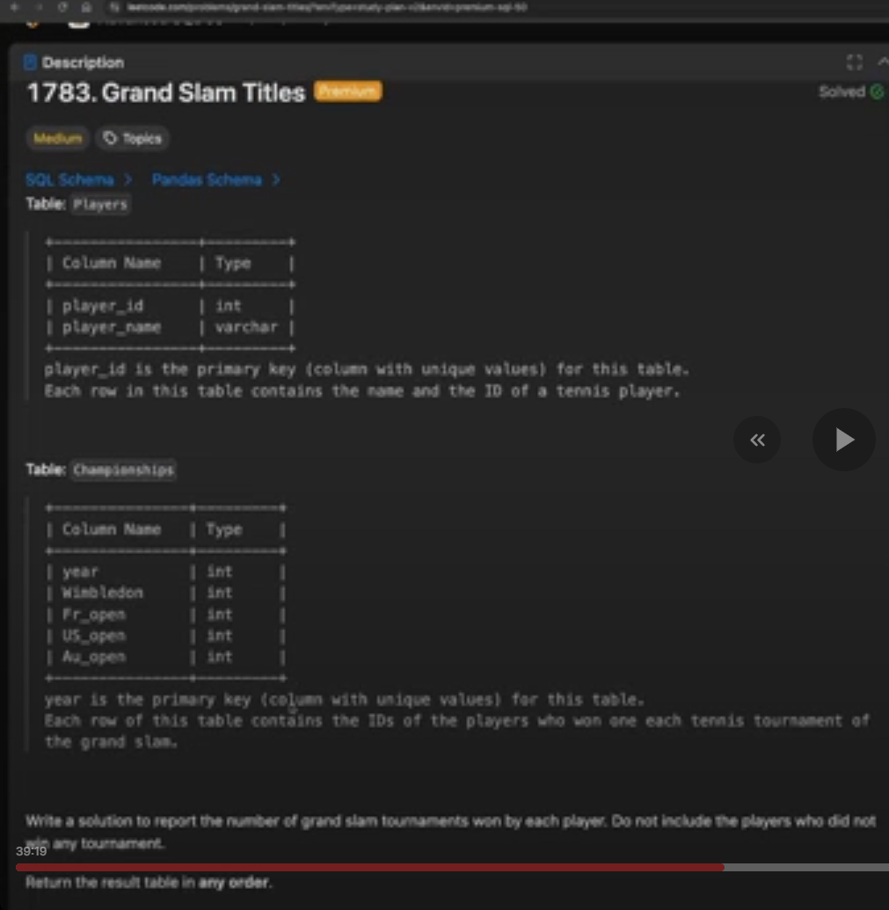

# 2. SQL Grand Slam Titles

## Question and image

**1783. Grand Slam Titles**

**Difficulty:** Medium

Table: `Players`

| Column Name | Type |
|---|---|
| player_id | int |
| player_name | varchar |

player_id is the primary key (column with unique values) for this table.

Each row in this table contains the name and the ID of a tennis player.

Table: `Championships`

| Column Name | Type |
|---|---|
| year | int |
| Wimbledon | int |
| Fr_open | int |
| US_open | int |
| Au_open | int |

year is the primary key (column with unique values) for this table.

Each row of this table contains the IDs of the players who won one each tennis tournament of the grand slam.

Write a solution to report the number of grand slam tournaments won by each player. Do not include the players who did not win any tournament.

Return the result table in any order.

The result format is in the following example.

**Example:**

**Input:**

Players table:

| player_id | player_name |
|---|---|
| 1 | Nadal |
| 2 | Federer |
| 3 | Novak |

Championships table:

| year | Wimbledon | Fr_open | US_open | Au_open |
|---|---|---|---|---|
| 2018 | 1 | 1 | 1 | 1 |
| 2019 | 1 | 1 | 2 | 2 |
| 2020 | 2 | 1 | 2 | 2 |

**Output:**

| player_id | player_name | grand_slams_count |
|---|---|---|
| 2 | Federer | 5 |
| 1 | Nadal | 7 |

No example explanation was supplied in the screenshots.

### Supplied screenshots

### Problem solving checklist

1. **Define the output:** state what one result row represents, the required columns, and the ordering.
2. **Understand the inputs:** identify table meanings, keys, relationships, duplicates, and NULLs.
3. **Explain the logic:** describe the steps, calculations, and comparisons in plain English.
4. **Choose SQL operations:** match each step to the SQL operations it needs.
5. **Plan intermediate results:** list the needed columns and what each intermediate row represents.
6. **Build gradually:** write one part, inspect its output, and check row counts after joins.
7. **Verify the answer:** check the sample, duplicates, missing matches, NULLs, arithmetic, boundaries, ties, and sorting.

Work through one step at a time during practice. Complete the current step before moving to the next.

## Schema

**Players**

| Column Name | Type |
|---|---|
| player_id | int |
| player_name | varchar |

- `player_id` is the primary key and identifies a tennis player.
- `player_name` is the name of the player.

**Championships**

| Column Name | Type |
|---|---|
| year | int |
| Wimbledon | int |
| Fr_open | int |
| US_open | int |
| Au_open | int |

- `year` is the primary key.
- The four tournament columns store the IDs of their winning players for that year.

## My solution — SQLite

Pending — awaiting my final SQLite solution.

## My solution — SQL Server

Pending — to be generated from my final SQLite solution.

## Official solution

Not provided for this practice set.
